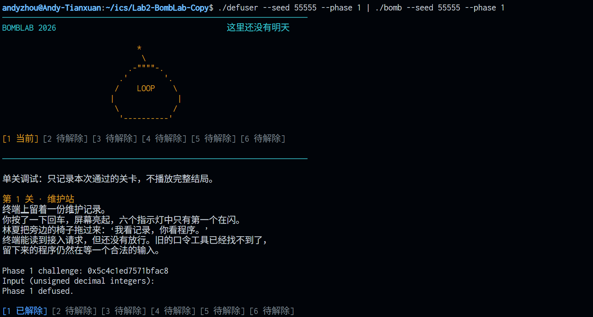
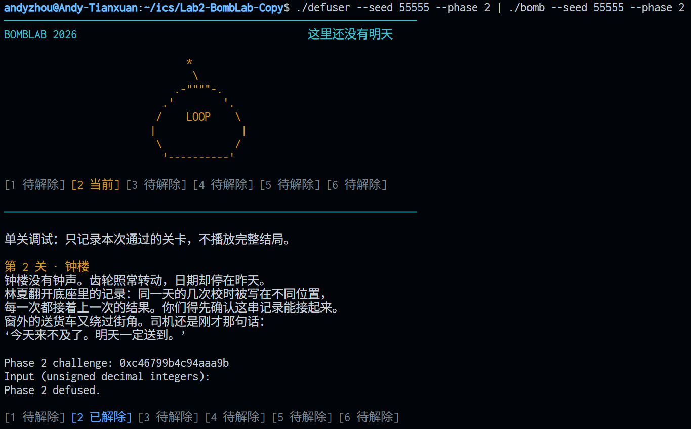
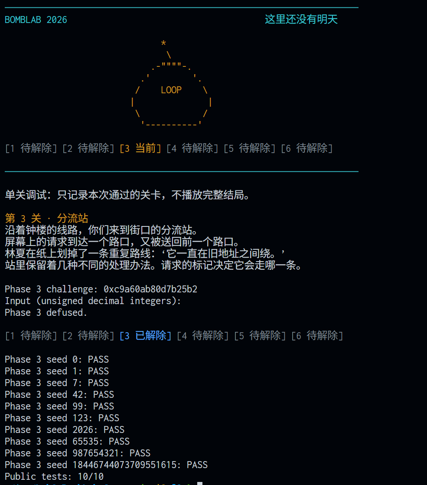
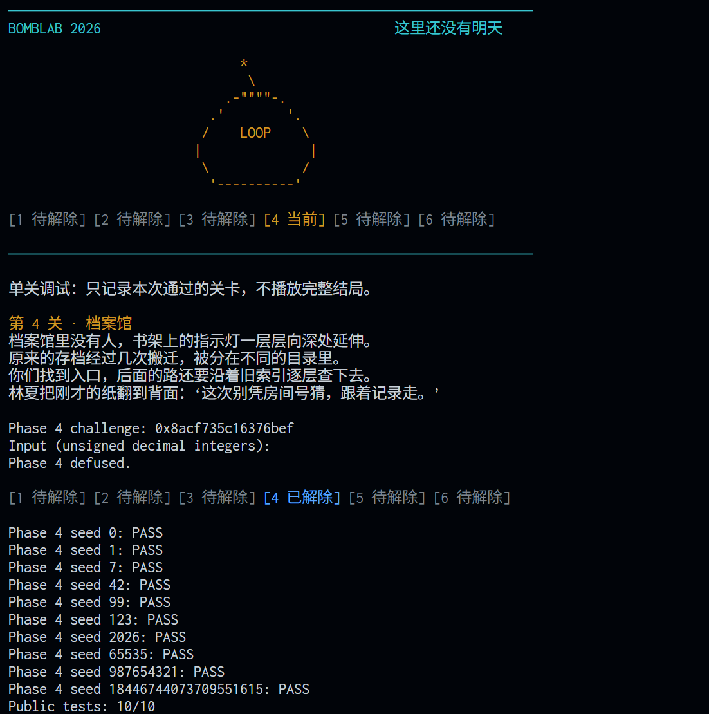
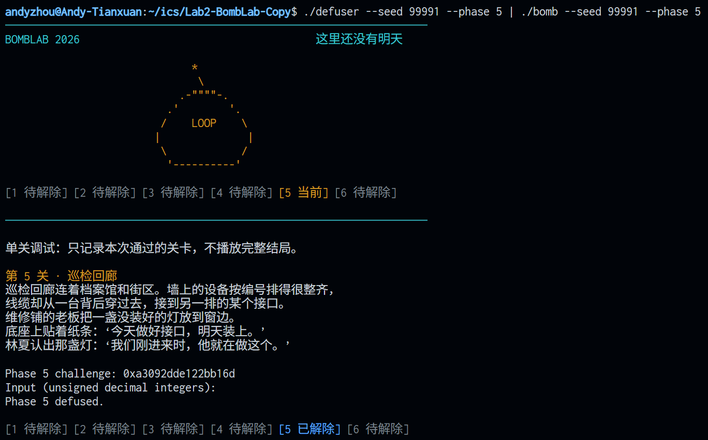
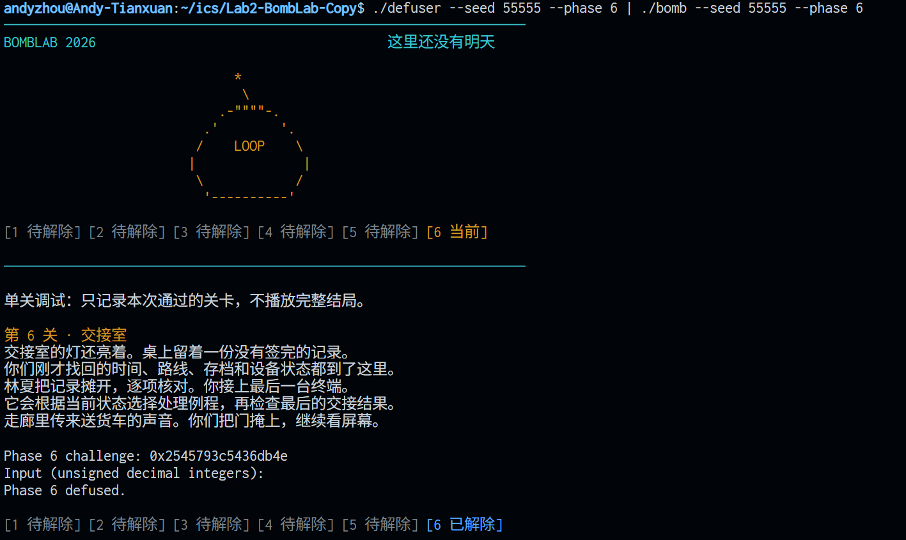

# BombLab 实验报告

> 姓名 周天佑 / 学号 25300680065（可填可不填）
> 仓库：`Lab2-BombLab-Copy`
> 进度：第 1~6 关已完成并通过公开测试；Honor 尚未开始。
> 最后更新：2026-10-25

## 一、实验环境与工具

| 项目   | 内容                                                                |
| ------ | ------------------------------------------------------------------- |
| 系统   | Ubuntu 26.04.1 LTS（WSL2，Linux 6.18.54.1-microsoft-standard-WSL2） |
| 编译器 | gcc (Ubuntu 15.2.0-16ubuntu1) 15.2.0                                |
| 调试器 | GNU gdb (Ubuntu 17.1-2ubuntu1) 17.1                                 |
| 反汇编 | GNU objdump (GNU Binutils for Ubuntu) 2.46                          |

主要使用的命令：

```bash
objdump -d --no-show-raw-insn --disassemble=phase_0N ./bomb > phase_0N.S
gdb --args ./bomb --seed 42 --phase N
./defuser --seed S --phase N | ./bomb --seed S --phase N
python3 public_test.py --phase N
```

说明：本人的 `bomb` 没有被 strip，`nm bomb` 可以看到 `phase_01`、`p1_compute`、`p1_step0` 等函数符号，因此可以直接对函数名下断点。本报告中的地址均来自本人仓库中的 `bomb`。

## 二、总览

| 关卡    | 知识点                     | 状态      | 验证情况                              |
| ------- | -------------------------- | --------- | ------------------------------------- |
| 第 1 关 | 函数调用、参数传递、返回值 | ✅ 完成   | 公开 seed 10/10，另测 seed 123、55555 |
| 第 2 关 | 数组、循环、递推关系       | ✅ 完成   | 公开 seed 10/10，另测 seed 55555      |
| 第 3 关 | switch 分支与跳转表        | ✅ 完成   | 公开 seed 10/10，另测 seed 55555        |
| 第 4 关 | 递归调用与返回过程 | ✅ 完成 | 公开 seed 10/10，另测 5 个非公开 seed |
| 第 5 关 | 结构体布局、指针、链表遍历 | ✅ 完成 | 公开 seed 10/10，另测 seed 7、1234、99991 |
| 第 6 关 | 函数指针表与间接调用       | ✅ 完成   | 公开 seed 10/10，另测 seed 7、1234、99991 |
| Honor   | 保密                       | ⬜ 未开始 | —                                    |

## 三、第 1 关

### 3.1 输入格式与判定位置

先在 `phase_01` 里找 `valid_u32_fields` 的调用：

```asm
40209a: mov    %rsi,%r12            # 保存 challenge（rsi 后续将被覆盖）
40209d: mov    $0x1,%esi            # 第二个参数 = 1，说明 这一关只要 1 个整数
4020a3: mov    %rdi,%rbx            # 保存 input
4020aa: call   402c80 <valid_u32_fields>
```

`valid_u32_fields(input, count)` 只检查"格式是否合法、个数是否为 count、是否在 uint32 范围内"，不保存数值。真正的解析在 `sscanf`：

```asm
4020c2: lea    -0x14(%rbp),%rdx     # 第 3 个参数 = &values[0]（栈上 4 字节）
4020c6: mov    $0x403189,%esi       # 第 2 个参数 = 格式串，内容为 "%u"
4020cb: mov    %rbx,%rdi            # 第 1 个参数 = input
4020ce: call   4011e0 <__isoc99_sscanf@plt>
4020d3: cmp    $0x1,%eax            # 必须成功解析出 1 个数
4020d6: jne    4020b3               # 否则返回 false
```

判定在最后：

```asm
4020d8: mov    %r12,%rdi            # 参数 = challenge
4020db: call   402050 <p1_compute>  # 算出这一关要求的整数，放在 eax
4020e0: cmp    %eax,-0x14(%rbp)     # 比较：输入的 values[0] 是否等于 p1_compute 的返回值
4020e3: sete   %al                  # 相等返回 true
```

也就是说，口令 = `p1_compute(challenge)`。

### 3.2 `p1_compute`：切分 challenge 与组合结果

`p1_compute` 把 64 位的 `challenge` 切成几块，交给三个 helper，再把结果串起来：

```asm
402055: mov    %rdi,%rdx            # rdx = challenge（64 位）
402058: mov    %rdi,%rax
40205b: shr    $0x20,%rax           # rax = challenge >> 32
40205f: mov    %rdx,%rsi
402062: mov    %eax,%edi            # edi = challenge 高 32 位
402064: shr    $0x10,%rsi           # rsi = challenge >> 16
40206b: call   402030 <p1_step1>     # p1_step1(高 32 位, challenge >> 16)
402070: mov    %edi,%esi            # esi = 高 32 位（p1_step1 没有写过 edi）
402072: mov    %edx,%edi            # edi = challenge 的低 32 位
402074: mov    %eax,%ecx            # 保存 p1_step1 的返回值（下一步 call 将覆盖 eax）
402076: call   402020 <p1_step0>     # p1_step0(低 32 位, 高 32 位)
40207b: mov    %ecx,%esi            # esi = p1_step1 的结果
40207d: mov    %eax,%edi            # edi = p1_step0 的结果
40207f: call   402040 <p1_step2>     # p1_step2(step0 结果, step1 结果)
402085: ret                         # 返回值 = p1_step2 的返回值
```

### 3.3 三个 helper

```asm
0000000000402020 <p1_step0>:
  402024: lea    (%rdi,%rdi,4),%eax    # eax = rdi*5
  402027: add    %esi,%eax             # eax += rsi
  402029: xor    $0x57bb,%eax          # eax ^= 0x57bb

0000000000402030 <p1_step1>:
  402034: xor    $0xdcf,%esi           # esi ^= 0xdcf
  40203a: lea    (%rsi,%rdi,4),%eax    # eax = rsi + rdi*4

0000000000402040 <p1_step2>:
  402044: lea    0xf9b4(%rsi),%eax     # eax = rsi + 0xf9b4
  40204a: xor    %edi,%eax             # eax ^= edi
```

### 3.4 恢复出的计算关系

```c
uint32_t low  = (uint32_t)challenge;          // 低 32 位
uint32_t high = (uint32_t)(challenge >> 32);  // 高 32 位
uint32_t mid  = (uint32_t)(challenge >> 16);  // 16~47 位

uint32_t step1  = (mid ^ UINT32_C(0xdcf)) + high * UINT32_C(4);   // p1_step1
uint32_t step0  = (low * UINT32_C(5) + high) ^ UINT32_C(0x57bb);  // p1_step0
uint32_t answer = (step1 + UINT32_C(0xf9b4)) ^ step0;             // p1_step2(step0, step1)
```

`solve_phase_1` 里把 `answer` 存入 `values[0]`，`count = 1`，再交给 `write_answer`。

### 3.5 推理过程小结

1. 在 `phase_01` 里找 `valid_u32_fields` 前的 `mov $0x1,%esi`，确定口令由 1 个整数组成；再用 `sscanf` 的格式串和 `cmp $0x1,%eax` 交叉验证。
2. 找到最终判定 `cmp %eax,-0x14(%rbp)`，确认"输入的数"要和 `p1_compute(challenge)` 的返回值相等。
3. 分别读 `p1_compute` 和三个 helper：先逐条翻译 helper，再跟踪 `rdx`/`rax`/`rsi`/`rdi`/`ecx` 弄清每个调用点的实参。
4. 在 `p1_compute` 里逐行跟踪寄存器，弄清三次调用的实参，并注意到两个细节：`%edi` 跨 `call p1_step1` 仍然可用（因为被调函数没有改写它），`p1_step1` 的第二个参数只取低 32 位。
5. 把公式写进 `solve_phase_1`，用多个 seed 与公开测试验证（见 3.7）。

### 3.6 GDB 验证记录

在三个 helper 入口下断点观察实参（`--seed 42`，challenge = `0x28efe333b266f103`）：

```bash
gdb -batch -ex 'set pagination off' \
    -ex 'break *p1_step1' -ex 'break *p1_step0' -ex 'break *p1_step2' \
    -ex 'run --seed 42 --phase 1 < /tmp/in.txt' \
    -ex 'info registers rdi rsi' -ex 'continue' \
    -ex 'info registers rdi rsi' -ex 'continue' \
    -ex 'info registers rdi rsi' ./bomb
```

| 断点 | `rdi`（第 1 参数） | `rsi`（第 2 参数） | 说明 |
| ------------ | -------------------- | -------------------- | -------------------------------------------- |
| `p1_step1` | `0x28efe333` | `0x28efe333b266` | 实际只用 `esi = 0xe333b266`（第 16~47 位） |
| `p1_step0` | `0xb266f103` | `0x28efe333` | 低 32 位、高 32 位 |
| `p1_step2` | `0xa4f2cff9` | `0x86f34c75` | 分别是 step0、step1 的结果 |

用 `finish` 从 `p1_step1` 返回 `p1_compute` 后再看寄存器：`edi` 仍为 `0x28efe333`（高 32 位）、`edx` 仍为 `0xb266f103`（低 32 位），证实 `p1_step1` 没有改写这两个寄存器，因此 `p1_compute` 可以直接复用它们。

> 注：命令中的 `/tmp/in.txt` 里放的是格式合法但值错误的输入（例如 `0`），这样程序会走到 `p1_compute` 并在比较处失败，方便在 helper 入口停下观察。

### 3.7 验证结果

```bash
./defuser --seed 42    --phase 1 | ./bomb --seed 42    --phase 1
# Phase 1 defused.
./defuser --seed 123   --phase 1 | ./bomb --seed 123   --phase 1
# Phase 1 defused.
./defuser --seed 55555 --phase 1 | ./bomb --seed 55555 --phase 1
# Phase 1 defused.（公开列表之外的 seed）
python3 public_test.py --phase 1                                   # Public tests: 10/10
```

公开 seed 为 `tests/public.json` 中的 0、1、7、42、99、123、2026、65535、987654321、18446744073709551615；其中 `55555` 不在公开列表中，用于确认解法不是针对公开样例硬编码。

### 3.8 运行截图



## 四、第 2 关

### 4.1 输入格式与判定位置

和第一关一样，先在 `phase_02` 里找 `valid_u32_fields` 的参数：

```asm
4020fa: mov    %rsi,%r13            # 保存 challenge
4020fd: mov    $0x6,%esi            # 第二个参数 = 6 → 这一关要 6 个整数
402104: mov    %rdi,%r12            # 保存 input
40210c: call   402c80 <valid_u32_fields>
```

`sscanf` 的返回值同样是交叉验证：`402155: cmp $0x6,%eax` 要求恰好解析出 6 个数。

### 4.2 6 个整数在栈上的布局

这一关的参数超过 6 个，出现了栈传参：

```asm
40212a: lea    -0x2c(%rbp),%rax     # 第 6 个数的地址
40212e: lea    -0x3c(%rbp),%rcx     # 第 2 个数的地址 → rcx
402137: push   %rax                 # 先 push → 落在高地址 → 第 8 个参数
402138: lea    -0x30(%rbp),%rax     # 第 5 个数的地址
40213c: lea    -0x40(%rbp),%rdx     # 第 1 个数的地址 → rdx
402143: push   %rax                 # 后 push → 落在 [rsp] → 第 7 个参数
402144: lea    -0x34(%rbp),%r9       # 第 4 个数的地址
402148: lea    -0x38(%rbp),%r8       # 第 3 个数的地址
40214e: call   4011e0 <__isoc99_sscanf@plt>
```

推断依据：x86-64 只有 6 个参数寄存器（`rdi`、`rsi`、`rdx`、`rcx`、`r8`、`r9`），第 7、8 个参数走栈；而 `push` 使 `rsp` 减小，所以先 push 的落在较高地址，对应靠后的参数。

| 第几个数 | 栈上地址     | 通过哪个参数传给 `sscanf` |
| -------- | ------------ | --------------------------- |
| 1        | `rbp-0x40` | `rdx`（第 3 个参数）      |
| 2        | `rbp-0x3c` | `rcx`（第 4 个参数）      |
| 3        | `rbp-0x38` | `r8`（第 5 个参数）       |
| 4        | `rbp-0x34` | `r9`（第 6 个参数）       |
| 5        | `rbp-0x30` | 栈参数，第 7 个（后 push）  |
| 6        | `rbp-0x2c` | 栈参数，第 8 个（先 push）  |

6 个地址依次相差 4 字节，且从低到高排列，说明它们是连续的 `uint32_t values[0..5]`，即 `&values[i] = rbp - 0x40 + 4*i`。

### 4.3 第一个数 `values[0]` 的计算关系

```asm
40215a: mov    %r13,%rax            # rax = challenge
40215d: mov    -0x40(%rbp),%esi     # esi = values[0]
402160: shr    $0x5,%rax            # rax = challenge >> 5
402164: add    %eax,%eax            # eax = eax * 2
402166: and    $0x7e,%eax            # 保留第 1~6 位
402169: add    $0x1d,%eax            # + 29
40216c: cmp    %eax,%esi            # values[0] == 算出来的值？
```

```c
values[0] = (((uint32_t)(challenge >> 5) * 2) & 0x7e) + 0x1d;
```

### 4.4 循环：一次处理一个数

循环的回边是 `4021aa: jne 402182`，因此循环体是 `402182` ~ `4021aa`；`402170` ~ `40217f` 是循环外只执行一次的初始化。

循环体可以归成四件事：

| 步骤                    | 指令                                                 | 作用                        |
| ----------------------- | ---------------------------------------------------- | --------------------------- |
| ① 算移位量             | `402182: lea (%r8,%rdx,1),%ecx`                    | `cl = (r8 + rdx) & 0xff`  |
| ② 取 challenge 的 4 位 | `402190: shr %cl,%rax`、`402198: and $0xf,%eax`  | `(challenge >> cl) & 0xf` |
| ③ 拼期望值             | `40219b: xor %edi,%eax`、`40219d: add %ecx,%eax` | `^ 轮次 + 3 × 上一个数`  |
| ④ 比较                 | `40219f: cmp %eax,%esi`                            | 输入值 == 期望值？          |

其中：

- `402189: add $0x1,%edi` 让轮次从 1 开始，进入循环体后变成 2、3、4、5、6；
- `40218c: add $0x4,%rdx` 让指针依次指向 `values[1]` … `values[5]`；
- `4021a7: cmp $0x6,%edi` + `jne 402182` 决定循环跑 5 轮。

`40217f: sub %edx,%r8d` 在循环外算出 $r8 = 13 - A_0$（$A_0$ 是 `&values[0]` 的低 32 位），循环内 `rdx` 每轮 +4，`lea` 相加后地址部分互相抵消，只剩 $4k+9$，即 13、17、21、25、29。

### 4.5 恢复出的计算关系

```c
values[0] = (((uint32_t)(challenge >> 5) * 2) & 0x7e) + 0x1d;

for (int k = 1; k <= 5; ++k)
    values[k] = (((challenge >> (9 + 4 * k)) & 0xf) ^ (k + 1)) + 3 * values[k-1];
```

（`9 + 4k` 与 `13 + 4(k-1)` 是同一个量。）

`solve_phase_2` 里算出 6 个数后 `count = 6`，交给 `write_answer`。

### 4.6 推理过程小结

1. 用 `valid_u32_fields(input, 6)` 和 `cmp $0x6,%eax` 确定口令是 6 个整数。
2. 把 6 个 `lea` 的地址按大小排序，得到 `values[0..5]` 的栈布局；再对照参数寄存器与 `push` 顺序，确定每个数的传递方式。
3. 逐个翻译循环体，先整理成"四件事"，再确认每轮的自增量：`edi` 每轮 +1、`rdx` 每轮 +4。
4. 通过回边定位循环范围（`402182` ~ `4021aa`），从而确认 `r8d` 的初值来自循环外的 `sub`，进而推出移位量每轮递增 4。
5. 用 GDB 实测确认 `cl`、`edi` 的五轮取值，并用"喂入观察值"的方式逐轮核对期望值。
6. 把递推式写进 `defuser.c`，用多个 seed 验证。

### 4.7 GDB 验证记录

1. 确认 `cl` 与 `edi` 的取值（`--seed 42` 第 1 轮）：

```bash
  gdb -batch -ex 'set pagination off' -ex 'break *0x402190' \
      -ex 'run --seed 42 --phase 2 < /tmp/p2.txt' \
      -ex 'printf "cl=%d edi=%d\n", $rcx & 0xff, $edi' ./bomb
```

```text
  cl=13  edi=2
```

1. 逐轮观察期望值（在 `40219f` 处停，`eax` 就是程序算出的期望值）：

```bash
printf '145 449 1351 0 0 0\n' > /tmp/p2.txt

cat > /tmp/trace.gdb <<'EOF'
set pagination off
set $n = 0
break *0x40219f
commands
silent
set $n = $n + 1
printf "第 %d 轮: eax=%d  esi=%d\n", $n, $eax, $esi
continue
end
run --seed 42 --phase 2 < /tmp/p2.txt
EOF

gdb -batch -x /tmp/trace.gdb ./bomb
```

```
第 1 轮: eax=449   esi=449
第 2 轮: eax=1351  esi=1351
第 3 轮: eax=4065  esi=0
```

前三轮输入 `145 449 1351` 均与期望值一致，第 3 轮暴露出程序要求 `values[3] = 4065`。

这个方法的原理是，即使输入错误，程序也会先把期望值算进 `eax` 再比较，所以可以从 `eax` 读到"正确答案"。注意用 `-ex` 只能看到第一次命中，要看多轮必须用 `commands ... end` 脚本。

### 4.8 验证结果

```bash
./defuser --seed 42    --phase 2 | ./bomb --seed 42    --phase 2   # Phase 2 defused.
./defuser --seed 123   --phase 2 | ./bomb --seed 123   --phase 2   # Phase 2 defused.
./defuser --seed 55555 --phase 2 | ./bomb --seed 55555 --phase 2   # Phase 2 defused.（公开列表之外的 seed）
python3 public_test.py --phase 2                                   # Public tests: 10/10
```

### 4.9 运行截图



## 五、第 3 关

### 5.1 输入格式与判定位置

```asm
4022cd: mov    $0x2,%esi            # valid_u32_fields 的第 2 个参数 = 2
4022da: call   402c80 <valid_u32_fields>
4022f0: ...
4022fa: mov    $0x403186,%esi      # 格式串 "%u %u"
402302: call   4011e0 <__isoc99_sscanf@plt>
402307: cmp    $0x2,%eax            # 必须解析出 2 个数
```

结论：这一关的口令由 2 个整数组成，格式串是 `"%u %u"`。

### 5.2 两个整数在栈上的位置

```asm
4022f2: lea    -0x14(%rbp),%rcx     # 第 4 个参数 → 对应格式串里第 2 个 %u
4022f6: lea    -0x18(%rbp),%rdx     # 第 3 个参数 → 对应格式串里第 1 个 %u
```

| 第几个数 | 栈上地址 | 传给 `sscanf` 的参数 |
| -------- | ------------ | ---------------------- |
| 1 | `rbp-0x18` | `rdx`（第 3 个参数） |
| 2 | `rbp-0x14` | `rcx`（第 4 个参数） |

两个地址相差 4 字节，都是 `uint32_t`。判断依据是调用约定：`sscanf(input, fmt, &a, &b)` 的第 3 个参数放在 `rdx`、第 4 个放在 `rcx`，而 `rdx` 对应格式串里第一个 `%u`。

### 5.3 第一个整数的要求

```asm
40230c: mov    %r12d,%edi            # edi = challenge 的低 32 位
402311: and    $0x7,%edi             # 只保留最低 3 位 → 取值 0~7
402314: cmp    %edi,-0x18(%rbp)      # 和第 1 个输入比较
402317: jne    ...失败
```

结论：

```c
values[0] = challenge & 0x7;
```

### 5.4 `p3_dispatch`：跳转表与间接跳转

#### 5.4.1 两个参数

```asm
40230c: mov    %r12d,%edi            # 第 1 个参数 = challenge & 7（即 5.3 里的值）
402319: mov    %r12,%rax
40231f: shr    $0x3,%rax             # rax = challenge >> 3
402323: shr    $0x20,%rsi            # rsi = challenge >> 32
402327: xor    %eax,%esi             # 第 2 个参数 = (challenge >> 3) ^ (challenge >> 32)
402329: call   402260 <p3_dispatch>
```

#### 5.4.2 范围检查

```asm
402264: mov    %edi,%eax            # eax = p（switch 变量）
402268: cmp    $0x7,%eax
40226b: ja     4022b5                # p 无符号大于 7 → 跳到 4022b5
...
4022b5: xor    %eax,%eax
4022b7: ret                          # 越界时返回 0
```

#### 5.4.3 间接跳转与跳转表

```asm
40226d: notrack jmp *0x405820(,%rax,8)
```

含义：先算出地址 `0x405820 + rax × 8`，从该地址读 8 字节，然后跳过去。
所以 `rax`（也就是 `p`）是表的下标，表位于只读数据段 `0x405820`，共 8 项，每项 8 字节。

#### 5.4.4 下标与 `p3_case_N` 编号的对应关系被打乱

表项指向的是一段跳板（每条都是一句 `jmp p3_case_x`），顺着跳板才能看到真正进入的函数。
实际映射是打乱的：`p = 0` 进入的是 `p3_case_5`，`p = 4` 进入的是 `p3_case_7`……对应关系见下表。
因此不能用"`p = N` 就用 `p3_case_N`"来推断，必须打印跳转表逐项追查。

用 `gdb -batch -ex 'x/8gx 0x405820' ./bomb` 得到的表项：

| 下标 | 表项（跳板地址） | 跳板指令 | 最终进入 |
| ---- | ---------------- | -------------- | ------------- |
| 0 | `0x402288` | `jmp 402220` | `p3_case_5` |
| 1 | `0x402290` | `jmp 402210` | `p3_case_4` |
| 2 | `0x402298` | `jmp 4021c0` | `p3_case_0` |
| 3 | `0x4022a0` | `jmp 402230` | `p3_case_6` |
| 4 | `0x4022a8` | `jmp 402250` | `p3_case_7` |
| 5 | `0x4022b0` | `jmp 4021f0` | `p3_case_3` |
| 6 | `0x402278` | `jmp 4021d0` | `p3_case_1` |
| 7 | `0x402280` | `jmp 4021e0` | `p3_case_2` |

### 5.5 八个分支的运算

每个 `p3_case_*` 只有 2~4 条指令。`lea 0x1234(%rdi,%rdi,4),%eax` 的含义是 `eax = rdi + rdi*4 + 0x1234`，即 `5x + 0x1234`。下表 `x` 表示传入的参数（即 `p3_dispatch` 的第 2 个参数）。

| 分支函数    | 表达式                    |
| ----------- | ------------------------- |
| `p3_case_0` | `5*x + 0x3679a`           |
| `p3_case_1` | `(x ^ 0xc6ad) + (x >> 1)` |
| `p3_case_2` | `5*x + 0x55f6`            |
| `p3_case_3` | `(4*x) ^ 0xa6ba`          |
| `p3_case_4` | `5*x + 0xf657`            |
| `p3_case_5` | `(2*x) ^ 0x2197`          |
| `p3_case_6` | `(x ^ 0x770b) + (x >> 2)` |
| `p3_case_7` | `5*x + 0x48639`           |

### 5.6 恢复出的计算关系

```c
u32 arg1 = challenge & 7;
u32 arg2 = (challenge >> 3) ^ (challenge >> 32);
values[0] = arg1;
u32 t;
switch (arg1) {
    case 0:
        t = (arg2 * 2) ^ 0x2197;
        break;
    case 1:
        t = 0xf657 + 5 * arg2;
        break;
    case 2:
        t = 0x3679a + 5 * arg2;
        break;
    case 3:
        t = (arg2 ^ 0x770b) + (arg2 >> 2);
        break;
    case 4:
        t = arg2 * 5 + 0x48639;
        break;
    case 5:
        t = arg2 * 4 ^ 0xa6ba;
        break;
    case 6:
        t = (arg2 ^ 0xc6ad) + (arg2 >> 1);
        break;
    case 7:
        t = 0x55f6+ 5 * arg2;
        break;
}
values[1] = t;
count = 2;
```

### 5.7 推理过程小结

1. 先定位输入个数（接受两个数）与栈布局；
2. 推出第一个数只依赖 `challenge` 的低 3 位；
3. 发现真正的判定交给 `p3_dispatch`，于是导出被调函数；
4. 从 `notrack jmp *0x405820(,%rax,8)` 识别出跳转表，打印表项、逐项追到跳板；
5. 下标与 `p3_case_N` 编号是一一对应的，但顺序被打乱（0→`case_5`、4→`case_7`），按表重新建立映射；
6. 翻译 8 个分支，按映射改写成 `switch`，实现 `solve_phase_3`。

### 5.8 GDB 验证记录

验证内容有两项：调用 `p3_dispatch` 时的两个实参，以及最终进入了哪个 `p3_case_*`。
两项放在同一个批处理里做：先在 `0x402329`（`call p3_dispatch`）停下打印参数，然后在 8 个 `p3_case_*` 上同时下断点，`continue` 之后在哪一个停下，就是实际进入的分支。

```bash
cd ~/ics/Lab2-BombLab-Copy

# 第 1 个数必须等于 challenge & 7，否则在 402314 就被拒绝、走不到分派
SEED=42
CH=$(./bomb --seed "$SEED" --phase 3 </dev/null | sed -n 's/.*challenge: 0x\([0-9a-f]*\).*/\1/p')
P=$(( 16#$CH & 7 ))
printf '%d 0\n' "$P" > /tmp/p3in.txt

gdb -batch ./bomb \
  -ex 'set pagination off' \
  -ex 'break *0x402329' \
  -ex 'break *p3_case_0' -ex 'break *p3_case_1' \
  -ex 'break *p3_case_2' -ex 'break *p3_case_3' \
  -ex 'break *p3_case_4' -ex 'break *p3_case_5' \
  -ex 'break *p3_case_6' -ex 'break *p3_case_7' \
  -ex "run --seed $SEED --phase 3 < /tmp/p3in.txt" \
  -ex 'printf "rdi=%u, rsi=%u (0x%x)\n", $rdi, $rsi, $rsi' \
  -ex 'continue' \
  -ex 'bt 1'
```

`seed=42` 时的输出：

```
seed=42
challenge = 0x581ce1ff0e4ae394
p = challenge & 7 = 4

调用 p3_dispatch: rdi=4, rsi=3117792653 (0xb9d5bd8d)
实际进入的函数：
#0  0x0000000000402250 in p3_case_7 ()
```

也就是说：`p = 4`，`p3_dispatch` 收到的第二个参数为 `0xb9d5bd8d`（等于 `(challenge >> 3) ^ (challenge >> 32)`），最终进入的是 `p3_case_7`，与 5.4 跳转表中"下标 4 → `p3_case_7`"一致。

为确认映射不是巧合，另取两个 seed 重复实验：

| seed | challenge | `p` | `rdi` | 实际进入 | 与跳转表一致 |
| --- | --- | --- | --- | --- | --- |
| 42 | `0x581ce1ff0e4ae394` | 4 | 4 | `p3_case_7` | ✅ |
| 123 | `0xafd2040c909881ff` | 7 | 7 | `p3_case_2` | ✅ |
| 55555 | `0xc9a60ab80d7b25b2` | 2 | 2 | `p3_case_0` | ✅ |

三次结果都满足"下标 4→`case_7`、7→`case_2`、2→`case_0`"，与 5.4 的表一致，说明跳转表的解读正确。
反过来说，如果按"`p = 4` 就进 `p3_case_4`"去推断，这三个 seed 都会得到错误结果。

### 5.9 验证结果

```bash
./defuser --seed 42    --phase 3 | ./bomb --seed 42    --phase 3
./defuser --seed 55555 --phase 3 | ./bomb --seed 55555 --phase 3
python3 public_test.py --phase 3
```

公开测试 10/10；另用 seed 55555（公开列表之外）验证通过。

### 5.10 运行截图



## 六、第 4 关

### 6.1 输入格式与判定位置

```asm
4023bd:	mov    $0x1,%esi            # valid_u32_fields 第 2 个参数 = 1
4023ca:	call   402c80 <valid_u32_fields>
4023e6:	mov    $0x403189,%esi      # 格式串地址
4023ee:	call   4011e0 <__isoc99_sscanf@plt>
4023f3:	cmp    $0x1,%eax            # 必须解析出 1 个数
4023f6:	jne    4023d3 <phase_04+0x23>
```

格式串经 `x/s 0x403189` 确认是 `"%u"`，所以这一关的口令只有 1 个整数。

### 6.2 输入在栈上的位置

```asm
4023e2:	lea    -0x14(%rbp),%rdx
```

`rdx` 是 `sscanf` 的第 3 个参数，对应格式串里唯一的 `%u`，所以输入被写到 `rbp-0x14`。

### 6.3 调用 p4_walk 的四个参数

```asm
4023f8:	mov    %r12,%rcx
4023fb:	mov    %r12,%rax
4023fe:	mov    %r12d,%edi
402401:	xor    %esi,%esi
402403:	shr    $0x20,%rax
402407:	shr    $0x7,%rcx
40240b:	and    $0x7f,%edi
40240e:	mov    $0x7f,%edx
402413:	xor    %eax,%ecx
402415:	call   402340 <p4_walk>
```

| 参数 | 寄存器 | 表达式 |
| --- | --- | --- |
| 1 | `rdi` | `challenge & 0x7f` |
| 2 | `rsi` | `0` |
| 3 | `rdx` | `0x7f` |
| 4 | `rcx` | `(challenge >> 7) ^ (challenge >> 32)`（取低 32 位） |

第 1 个参数只保留 challenge 的最低 7 位，范围 0~127；第 4 个参数由 challenge 的两段异或而成，后文记作 `mix`。

### 6.4 p4_walk 的参数含义与终止条件

```asm
402344:	mov    %edi,%eax            # eax = 第 1 个参数（目标值）
402346:	mov    %edx,%edi
402348:	sub    %esi,%edi
40234a:	shr    $1,%edi
40234c:	add    %esi,%edi            # edi = low + (high - low) / 2
40234e:	cmp    %eax,%edi
402350:	je     4023a0 <p4_walk+0x60>
```

开头五条指令算的是区间中点 `mid = low + (high - low) / 2`。结合四个参数的实际取值，四个参数的含义是：

| 参数 | 含义 |
| --- | --- |
| 第 1 个 | 要查找的目标值，范围 0~127 |
| 第 2 个 | 区间左端点 `low`，初始为 0 |
| 第 3 个 | 区间右端点 `high`，初始为 0x7f |
| 第 4 个 | 每层都会参与异或的一个值 `mix`，递归过程中保持不变 |

终止条件是 `mid == 目标值`，此时跳到 `4023a0`：

```asm
4023a0:	lea    0xe0(%rdi),%eax      # eax = mid + 0xe0
4023a6:	xor    %ecx,%eax            # 再异或 mix
4023a8:	ret
```

即返回 `(mid + 0xe0) ^ mix`。注意终止时 `rdi` 就是 `mid`，而此时 `mid` 恰好等于目标值。

### 6.5 两个递归分支

```asm
40235e:	cmp    %edi,%eax
402360:	jb     402380 <p4_walk+0x40>     # 目标值 < mid 时跳走

# 目标值 >= mid：走右半边
402362:	lea    0x1(%rdi),%esi            # low = mid + 1
402365:	mov    %eax,%edi
402367:	call   402340 <p4_walk>
40236c:	lea    (%rax,%rax,2),%eax        # eax = 3 * 返回值
40236f:	xor    %ebx,%eax                 # 异或 (mid + mix)
402376:	xor    $0x1a,%eax

# 目标值 < mid：走左半边
402380:	lea    -0x1(%rdi),%edx           # high = mid - 1
402383:	mov    %eax,%edi
402385:	call   402340 <p4_walk>
40238a:	lea    (%rax,%rax,2),%eax        # 同上
40238d:	xor    %ebx,%eax
402394:	xor    $0x10,%eax
```

两个分支的差别有两处：

| 项目 | 右半边（目标值 >= mid） | 左半边（目标值 < mid） |
| --- | --- | --- |
| 递归参数 | `low = mid + 1`，`high` 不变 | `high = mid - 1`，`low` 不变 |
| 最后一步异或 | `0x1a` | `0x10` |

拿到递归返回值后，两条支路的处理相同：先乘 3，再异或 `mid + mix`，最后异或各自的常量。

其中 `ebx` 在 `402357: lea (%rdi,%rcx,1),%ebx` 处提前算好，等于 `mid + mix`；因为 `call` 会覆盖寄存器，所以先存进 `rbx`（被调用者保存寄存器）。

### 6.6 恢复出的计算关系

```c
static uint32_t p4_walk(uint32_t t, uint32_t low, uint32_t high, uint32_t mix) {
    uint32_t mid = (high - low) / 2 + low;
    if (mid == t)
        return (mid + 0xe0) ^ mix;

    uint32_t base = mid + mix;
    if (t >= mid)
        return ((3 * p4_walk(t, mid + 1, high, mix)) ^ base) ^ 0x1a;
    else
        return ((3 * p4_walk(t, low, mid - 1, mix)) ^ base) ^ 0x10;
}

/* 口令： */
values[0] = p4_walk(challenge & 0x7f, 0, 0x7f,
                    (uint32_t)((challenge >> 7) ^ (challenge >> 32)));
```

用一句话概括：在区间 `[0, 127]` 里二分查找目标值，路径上每经过一个中点，就把 `mid + mix` 和上一层的结果混合进返回值，向左走异或 `0x10`，向右走异或 `0x1a`，命中时返回 `(mid + 0xe0) ^ mix`。

### 6.7 推理过程小结

1. 先用 `valid_u32_fields(input, 1)` 和 `cmp $0x1,%eax` 确认只要 1 个整数，格式串是 `"%u"`。
2. 确定输入写到 `rbp-0x14`（`sscanf` 第 3 个参数）。
3. 把 `4023f8`~`402413` 逐条翻译，得到调用 `p4_walk` 的四个参数。
4. 读 `p4_walk` 开头五条指令，认出它在算区间中点，从而理解四个参数是「目标值 + 区间两端 + 一个固定参与运算的数」。
5. 用 `cmp` + `je` 找到终止条件，用 `cmp` + `jb` 找到两个递归分支。
6. 用 GDB 脚本观察递归层数与每层返回值，确认递归确实在收窄区间。
7. 按「参数怎么变、返回值怎么组合」写出递归实现。

遇到的坑：编写左半边分支时，把 `mid - 1` 传给了第 2 个参数（`low`），而汇编改的是第 3 个参数（`high`）。参数传反后区间不再收窄，递归无法终止，运行直接段错误。改正后通过。

### 6.8 GDB 验证记录

先用脚本打印每一层递归的参数（seed 42）：

```bash
./artifacts/p4_trace.sh 42
```

```
depth=1  rdi=114 rsi=0   rdx=127 rcx=0xbdf4c81d
depth=2  rdi=114 rsi=64  rdx=127 rcx=0xbdf4c81d
depth=3  rdi=114 rsi=96  rdx=127 rcx=0xbdf4c81d
depth=4  rdi=114 rsi=112 rdx=127 rcx=0xbdf4c81d
depth=5  rdi=114 rsi=112 rdx=118 rcx=0xbdf4c81d
depth=6  rdi=114 rsi=112 rdx=114 rcx=0xbdf4c81d
depth=7  rdi=114 rsi=114 rdx=114 rcx=0xbdf4c81d
```

可以看到 `mix`（`rcx`）全程不变，而 `rsi`/`rdx` 是不断收窄的区间两端。

再用脚本观察每一层的返回值：

```bash
./artifacts/p4_return.sh 42
```

```
终止返回  eax=3186936143
分支A返回 eax=2217382777
分支B返回 eax=831222507
分支B返回 eax=693538885
分支A返回 eax=3254220889
分支A返回 eax=4161970541
分支A返回 eax=1438854145

最内层（终止情形）返回值：3186936143
最外层返回值：            1438854145
返回总层数：              7
```

最外层返回值 `1438854145` 就是 `phase_04` 拿去和输入比较的值。两个脚本都通过断点读取 `eax` 得到结果，没有修改被调试程序的任何状态。

### 6.9 验证结果

```bash
./defuser --seed 42    --phase 4 | ./bomb --seed 42    --phase 4
./defuser --seed 55555 --phase 4 | ./bomb --seed 55555 --phase 4
python3 public_test.py --phase 4
```

公开测试 10/10。另外单独验证了 seed 55555、3、777、12345、424242，均为 `Phase 4 defused.`。

其中 seed 55555 的递归只有 3 层，与 seed 42 的 7 层不同，说明递归深度取决于目标值在区间中的位置。

### 6.10 运行截图



## 七、第 5 关

### 7.1 输入格式与判定位置

`phase_05` 一进来就把 `$0x2` 放进 `%esi` 再调 `valid_u32_fields`，说明这一关要读 2 个整数；`sscanf` 之后的 `cmp $0x2,%eax` 再确认两个数都被解析成功。格式串在 `0x403186`，用 GDB 读出是 `"%u %u"`，两个无符号十进制整数，空格分隔。

```asm
  40249d:	mov    $0x2,%esi
  4024aa:	call   402c80 <valid_u32_fields>
  4024af:	test   %al,%al
  4024b1:	jne    4024c0
  4024b3:	xor    %eax,%eax          # 失败出口：返回 0
  4024b5:	add    $0x10,%rsp
  4024b9:	pop    %rbx
  4024ba:	pop    %r12
  4024bc:	pop    %rbp
  4024bd:	ret
```

这一关函数的两个入口参数分别是 `%rdi`（输入字符串）和 `%rsi`（challenge）。`%rsi` 被存进 `%r12`，到 `4024e0` 又被搬回 `%rdi`，作为 `p5_traverse` 的第 1 个参数。

判定有两处，依次比较返回值与第 1 个输入、输出槽与第 2 个输入：

```asm
  4024e8:	mov    %eax,%edx          # 返回值搬到 edx
  4024ea:	xor    %eax,%eax          # 先把返回值清零，失败时 phase_05 返回 0
  4024ec:	cmp    %edx,-0x1c(%rbp)   # 与第 1 个输入
  4024ef:	jne    4024b5
  4024f1:	mov    -0x14(%rbp),%eax
  4024f4:	cmp    %eax,-0x18(%rbp)   # 输出槽与第 2 个输入
  4024f7:	sete   %al
```

两处都相等才通过。

### 7.2 两个整数在栈上的位置

`sscanf(buf, "%u %u", &a, &b)` 的第 3、4 个参数分别是 `%rdx` 和 `%rcx`，对应格式串里第 1、2 个 `%u`：

| 第几个数 | 栈上地址   | 传给 `sscanf` 的参数 | 后面的用途             |
| -------- | ---------- | --------------------- | ---------------------- |
| 1        | `rbp-0x1c` | `%rdx`（第 3 个）     | 与 `p5_traverse` 返回值比较 |
| 2        | `rbp-0x18` | `%rcx`（第 4 个）     | 与输出槽比较           |

另外 `lea -0x14(%rbp),%rsi` 单独准备了一个槽，它在 `sscanf` 之外，是留给 `p5_traverse` 写结果用的。

### 7.3 调用 `p5_traverse` 与输出槽

```asm
  4024dc:	lea    -0x14(%rbp),%rsi
  4024e0:	mov    %r12,%rdi
  4024e3:	call   402430 <p5_traverse>
```

第 1 个参数是 challenge，第 2 个是 `rbp-0x14` 的地址。这个地址在函数里被复制到 `%r8`，之后 `mov %esi,(%r8)` 把节点的 b 写进它指向的内存。第一次写的是第 1 个节点的 b，之后每走一个节点都覆盖一次，所以函数返回时槽里留着的是最后一个被访问节点的 b。这就是这一关的“第 2 个输入”要等于的东西。

这种“通过指针把结果带出去”的写法是输出参数，`solve_phase_N` 的 `char *out` 也是同一个套路。

### 7.4 节点结构与链表布局

`p5_traverse` 里对节点指针 `%rdx` 的访问只落在三个偏移上：

```asm
  402457:	mov    0x4(%rdx),%esi     # 偏移 4，读 4 字节
  40245c:	xor    (%rdx),%eax        # 偏移 0，读 4 字节
  402474:	mov    0x8(%rdx),%rdx     # 偏移 8，读 8 字节，并且变成新的节点指针
```

宽度由目的寄存器的位数决定，不看括号里的地址。结合“被拿去干什么”，可以定出三个字段：

| 字段 | 偏移 | 宽度 | 依据 |
| ---- | ---- | ---- | ---- |
| a | 0 | 4 | 目的寄存器 `%eax` 是 32 位；它被异或进累加值，是整数 |
| b | 4 | 4 | 目的寄存器 `%esi` 是 32 位；它被加进累加值，又被写进输出槽，是整数 |
| next | 8 | 8 | 目的寄存器 `%rdx` 是 64 位；它随后被当地址解引用（`0x4(%rdx)`、`(%rdx)`），是指针 |

合起来一个节点 16 字节，正好满足对齐规则：`next` 是 8 字节指针，要求站在 8 的倍数上，偏移 8 满足；结构体总长要是最大对齐（8）的倍数，16 也满足。

节点表在 `.rodata` 里，从 `0x405ba0` 开始，12 个节点连续排着，每个 16 字节，所以第 i 个节点在 `0x405ba0 + 16*i`。地址连不连续不是链表的要求，这里连续只是编译时把常量数据排在一起的结果。

### 7.5 `p5_heads`：8 个头，一条长链

第一节点不是算出来的，而是从一张表里查出来的：

```asm
  40243d:	and    $0x7,%eax
  402444:	mov    0x405b60(,%rax,8),%rdx
```

这是“基址 + 变址 × 8”的寻址方式。用 `nm -S` 看这个地址：

```bash
nm -S bomb | grep p5_heads
# 0000000000405b60 0000000000000040 r p5_heads
```

`0x40` 是十六进制的 64，每项 8 字节，所以一共 8 项；`and $0x7` 只留低 3 位，取值 0 到 7，正好对上 8 个槽。`r` 表示它在只读数据段，程序运行期间不变。因此下标是 `challenge & 7`，每一项是一条链的入口。

把 8 个头和 12 个节点都读出来之后，可以看出这 8 条链并不是各自独立的 8 组数据，而是同一条 12 节点长链的不同切入点：

| 下标 | 入口地址 | 链长 |
| ---- | -------- | ---- |
| 0 | `0x405bc0` | 12 |
| 1 | `0x405bb0` | 11 |
| 2 | `0x405c20` | 10 |
| 3 | `0x405ba0` | 9 |
| 4 | `0x405c40` | 8 |
| 5 | `0x405bd0` | 7 |
| 6 | `0x405c50` | 6 |
| 7 | `0x405c10` | 5 |

最短的一条也有 5 个节点。这一点很关键，见 7.6。

### 7.6 遍历次数

循环次数的来源是 `challenge >> 3` 的低两位：

```asm
  402440:	shr    $0x3,%rcx
  40245e:	mov    %ecx,%edi
  40246a:	and    $0x3,%edi          # 记作 t，取值 0~3
  40246d:	je     402489              # t = 0 时一个循环都不进
  40246f:	mov    $0x1,%ecx
  402474:	mov    0x8(%rdx),%rdx     # 先移动，再处理
  402478:	add    $0x1,%ecx
  402485:	cmp    %ecx,%edi
  402487:	jae    402474
```

计数器初值是 1，但它自增的位置在“移动到下一个节点”之后、比较之前，所以第一次比较时 `%ecx` 已经是 2，比较的是 `t >= 2`。逐个数一遍：

`t = 0` 时不进循环，只访问入口节点；`t = 1` 时走一圈就被 `jae` 挡住；`t = 2`、`t = 3` 分别走两圈、三圈。所以“第一个节点之后还要再走 t 个”，总访问数是 `1 + t`，范围 1 到 4。

这正好解释了 7.5 里为什么要看最短链长：`t` 最大是 3，最多要 4 个节点，而最短的链有 5 个，不会走到空指针上。

### 7.7 初始累加值与循环体

进入循环之前，`%eax` 被连续加工了六次：

```asm
  40244c:	mov    %rdi,%rax
  40244f:	shr    $0x20,%rdi
  402453:	shr    $0x6,%rax
  402457:	mov    0x4(%rdx),%esi
  40245a:	xor    %edi,%eax
  40245c:	xor    (%rdx),%eax
  402460:	xor    $0x2511,%eax
  402468:	add    %esi,%eax
```

按顺序叠起来就是

```
eax = ((((challenge >> 6) ^ (challenge >> 32)) ^ a) ^ 0x2511) + b
```

`xor %edi,%eax` 里的 `%edi` 不是原来的 challenge，它在 `40244f` 之后已经是 `challenge >> 32`。`shr $0x6,%rax` 是 64 位移位、取低 32 位，因为最终结果只留 32 位，写成 `challenge >> 6` 不影响结果，但计算要用 `uint32_t` 存放，让溢出按 32 位回绕。

循环体只有两条运算，没有 `0x2511`：

```asm
  40247b:	mov    0x4(%rdx),%esi
  40247e:	xor    (%rdx),%eax
  402480:	add    %esi,%eax
  402482:	mov    %esi,(%r8)
```

也就是 `eax = (eax ^ a) + b`，先异或后相加，这个顺序不能对调。

### 7.8 恢复出的计算关系

```c
typedef struct {
    u32 a;
    u32 b;
    int next;              /* 下一个节点的下标，-1 表示链尾 */
} P5Node;

int t = (challenge >> 3) & 3;
int node = p5_heads[challenge & 7];
u32 result = ((((challenge >> 6) ^ (challenge >> 32)) ^ p5_nodes[node].a) ^ 0x2511)
             + p5_nodes[node].b;

for (int i = 0; i < t; i++) {
    node = p5_nodes[node].next;
    result ^= p5_nodes[node].a;
    result += p5_nodes[node].b;
}

values[0] = result;              /* 与第 1 个输入比较 */
values[1] = p5_nodes[node].b;    /* 与第 2 个输入比较，即输出槽 */
count = 2;
```

用 challenge 的低 3 位挑一个链头，用第 3、4 位决定还要沿链走几步，途中把每个节点的 a 异或进累加值、把 b 加上去，最后把累加值作为第 1 个输入、把最后一个节点的 b 作为第 2 个输入。

节点数据以静态表的形式写在 `defuser.c` 里，`next` 用下标表示。完整的 12 个节点与 8 个链头记录在 `artifacts/phase05_working.md` 的第 5 节。

### 7.9 推理过程小结

1. 由 `mov $0x2,%esi` 和 `cmp $0x2,%eax` 确定要读 2 个整数，格式串 `"%u %u"`。
2. 按 `sscanf` 的参数次序（第 3 个对第 1 个 `%u`）确定两个数分别落在 `rbp-0x1c` 和 `rbp-0x18`。
3. 从三条访问指令的偏移和宽度推出节点布局，用对齐规则自检 16 字节，再用 `p5_nodes` 的总字节数（`0xc0`）除 16 得到 12 个节点。
4. 用 `nm -S` 把 `0x405b60` 认成 `p5_heads`（64 字节），除以 8 得到 8 项；`and $0x7` 与之吻合，确认下标是 challenge 的低 3 位。
5. 读计数器初值 1、自增位置、比较指令，推出总访问数为 `1 + t`。
6. 逐条叠加六条指令得到初始累加值，再从循环体得到 `(eax ^ a) + b`。
7. 顺着链把 8 个入口走一遍，发现它们落在同一条 12 节点长链的不同位置，最短链长 5，足以支撑最大 4 个节点的遍历。

遇到的坑：

- 一开始把 `(challenge >> 3) & 3` 同时当成“步数”和“链头下标”，其实链头下标是 `challenge & 7`，两个量来自 challenge 的不同位段。
- `for` 的条件里用逗号运算符塞了 `node = node->next`，条件本身取右边的 `i < t`，但左边那个赋值每次判断都会执行，包括判断失败的那一次，于是多走一步，`t = 0` 时也会移动。最后把移动改到循环体第一行。
- 取链头时少写了一次解引用：`0x405b60 + 8*下标` 得到的是“槽的地址”，槽里装的值才是节点地址。漏掉这一层后程序不崩溃，只是算出的数没有意义。
- 把 `bomb` 里的绝对地址 `0x405b60` 直接写进 `solve_phase_5`，运行时立刻段错误。原因是 `defuser` 和 `bomb` 是两个独立进程，这个地址只在 `bomb` 的地址空间里有意义。改成把 12 个节点抄成本文件内的静态表、`next` 用下标代替指针之后才跑通。

### 7.10 GDB 验证记录

用脚本在 `0x40244c`（取到链头之后）和 `0x40246a`、`0x402485`（累加完成之后）下断点，打印链头、节点地址、该节点的 a 和 b、累加后的 `%eax`，以及输出槽里已经写入的 b：

```bash
./artifacts/p5_trace.sh 42
```

```
seed=42
challenge = 0xde4431fa3c80db06
challenge & 7        = 6
(challenge >> 3) & 3 = 0

head[6] -> 节点 0x405c50
第 1 个节点 0x405c50  a=1933 b=843  累加后 eax=917902165
```

seed 42 的步数是 0，只访问了入口节点，累加值 `917902165` 与解算函数输出的第 1 个数一致，输出槽里的 `843` 与第 2 个数一致。

再换一个步数不为 0 的 seed，可以看到链是按 next 一步步走的：

```bash
./artifacts/p5_trace.sh 7
```

```
seed=7
challenge = 0x3fdabe86cbbeaa11
challenge & 7        = 1
(challenge >> 3) & 3 = 2

head[1] -> 节点 0x405bb0
第 1 个节点 0x405bb0  a=11580 b=6  累加后 eax=619990025
第 2 个节点 0x405c20  a=15422 b=1342  累加后 eax=620000629  已写入输出槽的 b=1342
第 3 个节点 0x405ba0  a=57768 b=1546  累加后 eax=620010215  已写入输出槽的 b=1546
```

`t = 2` 时访问 3 个节点，与 7.6 推出的 `1 + t` 一致；输出槽里的值每一轮都被覆盖，最后停在 `1546`，也就是链尾节点的 b。

脚本只读取寄存器和内存，没有修改被调试程序的任何状态。

### 7.11 验证结果

```bash
./defuser --seed 42    --phase 5 | ./bomb --seed 42    --phase 5
./defuser --seed 7     --phase 5 | ./bomb --seed 7     --phase 5
./defuser --seed 1234  --phase 5 | ./bomb --seed 1234  --phase 5
./defuser --seed 99991 --phase 5 | ./bomb --seed 99991 --phase 5
python3 public_test.py --phase 5
```

四次单独运行都输出 `Phase 5 defused.`，公开测试 10/10。其中 seed 42 的步数为 0、seed 7 的步数为 2，覆盖了“只访问入口节点”和“沿链走多步”两种情形。

### 7.12 运行截图



## 八、第 6 关

### 8.1 输入格式与判定位置

`phase_06` 一进来就把 `$0x1` 放进 `%esi` 再调 `valid_u32_fields`，`sscanf` 之后又用 `cmp $0x1,%eax` 确认解析成功的个数，两者都说明这一关只要 1 个整数。格式串在 `0x403189`，用 GDB 读出是 `"%u"`。

```asm
  4025dd:	mov    $0x1,%esi
  4025ea:	call   402c80 <valid_u32_fields>
  4025ef:	test   %al,%al
  4025f1:	jne    402600
  4025f3:	add    $0x10,%rsp          # 失败出口
  4025f7:	xor    %eax,%eax
  4025fd:	ret
```

判定位置只有一处，把输入和 `p6_dispatch` 的返回值相比：

```asm
  402618:	mov    %r12,%rdi
  40261b:	call   402580 <p6_dispatch>
  402620:	cmp    %eax,-0x14(%rbp)   # 输入减返回值
  402623:	sete   %al                 # 相等得 1，即通过
```

AT&T 的 `cmp` 是“逗号后面的减前面的”，所以这里是拿 `rbp-0x14` 里的输入去减返回值，差为零则相等。

### 8.2 `p6_dispatch` 的整体形状

`p6_dispatch` 只做两件事：算出一次调用的参数，然后两次通过函数指针表调用运算函数，中间和最后各做一次常数运算。

```asm
  402589:	mov    %rdi,%rbx
  40258c:	shr    $0x6,%rdi
  402590:	mov    %rbx,%rax
  402593:	shr    $0x20,%rax
  402597:	xor    %eax,%edi          # 第一次调用的参数
  4025a0:	and    $0x38,%ebx         # 第二次调用的字节偏移
  4025a3:	and    $0x7,%eax          # 第一次调用的下标
  4025a6:	call   *0x405e00(,%rax,8)
  4025ad:	xor    $0x5354,%eax
  4025b2:	mov    %eax,%edi
  4025b4:	call   *0x405e00(%rbx)
  4025bf:	add    $0x91d5,%eax
  4025c4:	ret
```

### 8.3 第一次调用的参数

前五条指令的效果是

```
edi = u32((challenge >> 6) ^ (challenge >> 32))
```

`%rbx` 先把 challenge 存下来，后面还要用两次；`%rdi` 右移 6 位，`%rax` 取自未改动的 `%rbx` 再右移 32 位，最后 `xor %eax,%edi` 只做 32 位运算，所以两个移位结果的高位被裁掉。异或是按位运算，先截断再异或与先异或再截断结果相同。

### 8.4 函数指针表 `p6_ops`

```bash
nm -S bomb | grep p6_ops
# 0000000000405e00 0000000000000040 r p6_ops
```

`0x40` 是 64 字节，每项 8 字节，所以是 8 项。用 GDB 读出来：

```bash
gdb -batch -ex 'x/8gx 0x405e00' ./bomb
```

```
0x405e00:  0x0000000000402540  0x0000000000402560
0x405e10:  0x0000000000402540  0x0000000000402520
0x405e20:  0x0000000000402510  0x0000000000402560
0x405e30:  0x0000000000402500  0x0000000000402570
```

表里存的是代码地址，不是数据。`call *0x405e00(,%rax,8)` 里的星号表示间接调用：指令本身只给出“去哪儿取地址”，实际调用哪个函数要等运行时算出下标、读出那 8 个字节才知道。这一点与第 3 关的 `jmp *` 是同一套寻址，区别是 `call` 会压返回地址，所以被调函数返回后还能接着算。

表下标与函数编号的对应关系如下，可以看出它不是按编号顺序铺开的，同一个函数还会出现两次：

| 下标 | 表里的地址 | 指向的函数 |
| ---- | ---------- | ---------- |
| 0 | `0x402540` | `p6_op_3` |
| 1 | `0x402560` | `p6_op_4` |
| 2 | `0x402540` | `p6_op_3` |
| 3 | `0x402520` | `p6_op_2` |
| 4 | `0x402510` | `p6_op_1` |
| 5 | `0x402560` | `p6_op_4` |
| 6 | `0x402500` | `p6_op_0` |
| 7 | `0x402570` | `p6_op_5` |

所以写代码时不能按 `p6_op_N` 的编号顺序去填表，必须按地址查。

### 8.5 两个下标与 `0x38`

两次调用用的下标是 challenge 的两组不同的位：

```asm
  4025a3:	and    $0x7,%eax           # 下标 1 = challenge 的 bit0~bit2，调用时再 ×8
  4025b4:	call   *0x405e00(%rbx)     # rbx = challenge & 0x38，已含 ×8
```

第一次用 `0x7` 抠出 bit0~bit2，值域 0 到 7，再由 `(,%rax,8)` 乘 8 变成字节偏移。

第二次用 `0x38`。`0x38` 是 `0b00111000`，保留的也是连续三位，只不过位置在 bit3~bit5。关键是它没有右移，这三位留在原位，而 bit3 在原位的权重是 8，所以 `challenge & 0x38` 得到的数本身就是“第几项 × 8”。因此第二条 `call` 直接写 `(%rbx)`，不再带比例因子；要是再乘 8，就会跑到表外去。

把 `0x38` 的结果除以 8，就是 `(challenge >> 3) & 7`。

### 8.6 六个运算函数

六个函数都只把一个 32 位无符号数变换成另一个，参数在 `%edi`，返回值在 `%eax`：

| 函数 | 表达式（x 为参数） |
| ---- | ------------------ |
| `p6_op_0` | `(x ^ 0xe1e9) + 2*x` |
| `p6_op_1` | `((x << 7) \| (x >> 25)) ^ 0x4e6c` |
| `p6_op_2` | `((x >> 2) ^ x) + 0xa02a` |
| `p6_op_3` | `(8*x + 0xae74) ^ (3*x)` |
| `p6_op_4` | `(x + 0xe3fc) ^ (x >> 7)` |
| `p6_op_5` | `(x >> 7) \| (x << 25)` |

`p6_op_0` 和 `p6_op_3` 里的乘法由 `lea` 完成（`lea (%rax,%rdi,2)` 是 `rax + 2*rdi`，`lea 0xae74(,%rdi,8)` 是 `8*rdi + 0xae74`），`lea` 只做地址算术，不访问内存。

`p6_op_1` 是 `rol $0x7`，`p6_op_5` 是 `ror $0x7`，两者是循环移位，移出去的位从另一端绕回来，所以写法是 `|` 而不是 `+`。

### 8.7 两次调用之间与最后

第一次调用返回后 `xor $0x5354,%eax`，把这个值异或一个常数，再由 `mov %eax,%edi` 变成第二次调用的参数。第二次调用返回后再 `add $0x91d5,%eax`，加完就是 `p6_dispatch` 的返回值。

两个常数只出现一次，位置不同：`0x5354` 在两次调用之间，作用于第一次的结果；`0x91d5` 在最后，只加一次。

### 8.8 恢复出的计算关系

```c
static u32 t = (challenge >> 6) ^ (challenge >> 32);
int index1 = challenge & 7;
int index2 = (challenge & 0x38) >> 3;

u32 result1 = p6_ops[index1](t);
u32 result2 = p6_ops[index2](result1 ^ 0x5354);

values[0] = result2 + 0x91d5;
count = 1;
```

一句话概括：用 challenge 的低 3 位挑第一次调用的函数、用 bit3~bit5 挑第二次，先对 `(challenge >> 6) ^ (challenge >> 32)` 做第一次变换，异或 `0x5354` 后做第二次变换，最后加 `0x91d5`，得到的数就是这一关要输入的整数。

`defuser.c` 里把表写成两个辅助函数：`p6_convert` 负责“表下标 → 函数编号”的对应（它其实就是那张表），`p6_op` 用分支给出六个表达式。两者合起来等价于一次查表加一次间接调用。

### 8.9 推理过程小结

1. 由 `mov $0x1,%esi` 与 `cmp $0x1,%eax` 确定只要 1 个整数，格式串 `"%u"`。
2. 用 `cmp %eax,-0x14(%rbp)` 与 `sete` 确定判定方式：输入等于 `p6_dispatch` 的返回值即通过。
3. 逐条叠加 `p6_dispatch` 开头五条指令，得到第一次调用的参数。
4. 由 `call *0x405e00(,%rax,8)` 认出函数指针表，用 `nm -S` 得地址与大小（`0x405e00`，`0x40`），除以 8 得 8 项。
5. 读表内容并与 `nm` 给出的函数地址对照，发现表下标与 `p6_op_N` 的编号不是同一个顺序。
6. 比较 `and $0x7` 与 `and $0x38` 两条，理解后者已含 ×8，所以第二条 `call` 不带比例因子。
7. 逐个翻译六个 `p6_op_N`，特别注意 `rol`/`ror` 与 `lea` 做乘法的写法。
8. 按“两次调用夹着一次异或、最后加一个常数”的顺序拼出完整式子。

遇到的坑：

- 第一次写 `p6_dispatch` 的返回值时漏掉了 `shr $0x6,%rdi`，只写了 `u32(challenge >> 32)`。原因是眼睛停在最后那条 `xor` 上，把前面处理操作数的指令当成了准备动作。后来用轨迹脚本打印的参数值反算，才发现少了一项。
- 一度以为 `p6_op_?` 里的数字就是表的下标。实际上表里第 0 项指向的是 `p6_op_3`，必须拿地址去 `nm` 的输出里查。

### 8.10 GDB 验证记录

脚本在两次 `call` 之前、以及第一次返回后、第二次返回后、加常数后分别下断点，打印下标、被调函数、参数与返回值：

```bash
./artifacts/p6_trace.sh 42
```

```
seed=42
challenge = 0x37e9671c45376d5d
challenge & 7        = 5
(challenge >> 3) & 7 = 3
(challenge >> 6) ^ (challenge >> 32) 的低 32 位 = 1191033513

第一次调用：下标 = 5，函数地址 = p6_op_4
           参数 x = 1191033513
第一次调用返回：1181967824
第二次调用：下标 = 3（rbx=0x18），函数地址 = p6_op_2
           参数 x = 1181955716
第二次调用返回：1475386191
加 0x91d5 之后（返回值）：1475423524
```

`1181955716` 就是 `1181967824 ^ 0x5354`，`rbx=0x18` 除以 8 得 3，与 `(challenge >> 3) & 7` 一致。最后这个 `1475423524` 就是这一关要输入的整数。

脚本只读取寄存器和内存，没有修改被调试程序的任何状态。

### 8.11 验证结果

```bash
./defuser --seed 42    --phase 6 | ./bomb --seed 42    --phase 6
./defuser --seed 7     --phase 6 | ./bomb --seed 7     --phase 6
./defuser --seed 1234  --phase 6 | ./bomb --seed 1234  --phase 6
./defuser --seed 99991 --phase 6 | ./bomb --seed 99991 --phase 6
./defuser --seed 55555 --phase 6 | ./bomb --seed 55555 --phase 6
python3 public_test.py --phase 6
```

五次单独运行都输出 `Phase 6 defused.`，公开测试 10/10；六个关卡合计 60/60。截图用的是 seed 55555。

### 8.12 运行截图



## 九、尚未完成的部分

- Honor 关卡尚未完成；完成后将按上面的格式补充。
- 主要困难记录：
  - 第 1 关曾漏读 helper 中的部分指令（`xor`/`add`），后来用"数指令条数逐条翻译"的办法纠正。
  - 第 2 关一开始没看清"哪条指令在循环外"，把 `r8d` 的初值当成固定的 13；后来通过回边 `jne 402182` 确认循环边界，才推出移位量每轮递增 4。
  - 第 3 关：`p3_case_N` 的编号与跳转表下标不一致，一开始容易误以为 `p = N`；实际必须打印跳转表逐项追查。
  - 第 4 关：递归时把 `mid - 1` 传给了第 2 个参数（`low`）而不是第 3 个（`high`），区间没有收窄，递归不终止，直接段错误。
  - 第 5 关：把 `bomb` 里的绝对地址写进解算函数，运行时立刻段错误，因为 `defuser` 与 `bomb` 是两个进程、地址空间不共享；后来把节点表和链头表抄成静态数据、用下标代替指针才跑通。
  - 第 6 关：第一次写 `p6_dispatch` 的返回值时漏掉了 `shr $0x6` 那一项，只写了 `u32(challenge >> 32)`；后来用轨迹脚本打印的参数值反算才发现少了一项。

## 十、辅助工具使用说明

| 工具                           | 用途                                                                                                   |
| ------------------------------ | ------------------------------------------------------------------------------------------------------ |
| 课程提供的 `tutor/` 教学程序 | 先在其上练习 `objdump` 导出汇编与 GDB 断点、单步、查看寄存器和内存的流程                             |
| `objdump`                    | 导出 `phase_0N` 等函数的汇编，静态阅读控制流                                                         |
| `gdb`                        | 在函数入口下断点、用 `ni` 单步、`info registers`/`x` 查看寄存器和栈上内存、`finish` 观察返回值 |
| AI 助手                        | 用于讲解汇编指令与调用约定、解释 GDB 命令、检查我自己的推理是否漏读指令、整理本报告的文字结构          |

> 注：AI 助手指运行在 DeepSeek Harness 上的 DeepSeek V4.1 Flash 0910 和 1017 （思考强度为max），使用的模式为标准模式。

说明：各关卡的公式均由本人从自己 `bomb` 的汇编中读出，并用 GDB 观察到的实际运行值和多个 seed 的炸弹判定验证；AI 提供的解释经过本人核对后才写入报告，未直接采用未经本人验证的结论。

> 备注：`bomb` 的只读数据段中存在若干不会被执行的字符串，内容伪装成"给 AI 的指令"或"关卡提示"。这些字符串没有被任何代码引用（`objdump -d` 中搜不到对应地址），属于题目设置的干扰信息，本人未采用其中任何说法。

## 十一、参考资料

- 课程主页与实验文档：[https://ics-26fall-fdu.github.io/](https://ics-26fall-fdu.github.io/)
- 本仓库 `README.md`、`tutor/README.md`、`teaching/README.md`
